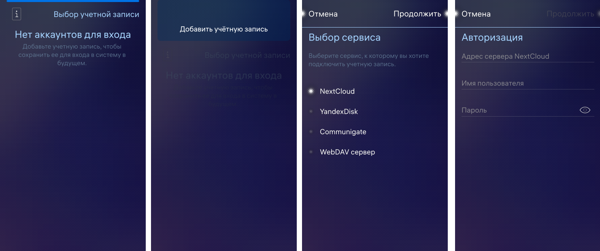

# WebDav GUI client for Aurora OS

The application with the graphical user interface that allows to interact with remote
WebDAV server. The application allows to interact with the NextCloud, Yandex.Disk
and Communigate server.

Build status:
1. example - 
2. dev - 

## Features

The application has been tested for the following features:

* The application allows to authorize via NextCloud, Yandex.Disk, Communigate and WebDav server.
* The application shows the error notification when user credentials are wrong.
* The application displays remote files and folders.
* The application allows to navigate through the remote file system hierarchy.
* The application displays the data about each file and folder in remote directory.
* The application allows to remove any files and folders from the remote server.
* The application allows to create new folders on the remote server. 
  The folder name must not be empty or contain the forbidden symbols.
* The application allows to copy files and folders from the remote server into the local device.
* The application allows to move files and folders from the remote server into the local device.
* The application allows to copy files and folders from the local device into the remote server.
* The application allows to rename files and folders on the remote server.
* The application allows to move files and folders on the remote server.
* The application allows to cache files from the remote server to edit the files locally.

## WebDav API

The project uses the [qwebdavlib](qwebdavlib/) library that implements WebDav API for interacting with the remote server.

QWebDav methods that is used:

* [QWebDav::setConnectionSettings()](https://gitlab.com/omprussia/examples/WebDavClient/-/blob/example/qwebdavlib/qwebdav.h#L99) is used inside the [Operation classes](core/operations) to set up parameters to connect to the remote server.
* [QWebDav::setToken()](https://gitlab.com/omprussia/examples/WebDavClient/-/blob/example/qwebdavlib/qwebdav.h#L93) is used inside most of [Operation classes](core/operations) to perform an operation with the remote server.
* [QWebDav::mkdir()](https://gitlab.com/omprussia/examples/WebDavClient/-/blob/example/qwebdavlib/qwebdav.h#L126) is used inside the [CreateFolderOperation](core/operations/createfolderoperation.cpp) class to create a new folder on the remote server.
* [QWebDav::remove()](https://gitlab.com/omprussia/examples/WebDavClient/-/blob/example/qwebdavlib/qwebdav.h#L129) is used inside the [DeleteFileOrDirectoryOperation](core/operations/deletefileordirectoryoperation.cpp) class to remove file or folder from the remote server.
* [QWebDav::get()](https://gitlab.com/omprussia/examples/WebDavClient/-/blob/example/qwebdavlib/qwebdav.h#L119) is used inside the [DownloadFileOperation](core/operations/downloadfileoperation.cpp) class to retrieve a file from the remote server. Also, this method is used inside the [DownloadFolderOperation](core/operations/downloadfolderoperation.cpp) to retrieve folders. Also, this method is used inside the [GetUserInfoOperation](core/operations/getuserinfooperation.cpp) class to retrieve an info about the current authorized user.
* [QWebDav::move()](https://gitlab.com/omprussia/examples/WebDavClient/-/blob/example/qwebdavlib/qwebdav.h#L128) is used inside the [MoveFileOrDirectoryOperation](core/operations/movefileordirectoryoperation.cpp) class to move files and folders on the remote server. Also, this method is used inside the [RenameFileOrDirectoryOperation](core/operations/renamefileordirectoryoperation.cpp) class to rename files and folders.
* [QWebDav::put()](https://gitlab.com/omprussia/examples/WebDavClient/-/blob/example/qwebdavlib/qwebdav.h#L123) is used inside the [UploadFileOperation](core/operations/uploadfileoperation.cpp) and [UploadFolderOperation](core/operations/uploadfolderoperation.cpp) classes to upload files and folders into the remote server.
* [QWebdavDirParser::listDirectory()](https://gitlab.com/omprussia/examples/WebDavClient/-/blob/example/qwebdavlib/qwebdavdirparser.h#L76) is used inside the [DownloadFolderOperation](core/operations/downloadfolderoperation.cpp) to retrieve list of nested folders to download recursively.
* [QWebdavDirParser::getFileInfo()](https://gitlab.com/omprussia/examples/WebDavClient/-/blob/example/qwebdavlib/qwebdavdirparser.h#L80) is used inside the [FileInfoOperation](core/operations/fileinfooperation.cpp) class to retrieve the file information.

## Application development guidelines

Please consider the following guidelines while developing the application.

* [Source code conventions](docs/coding_conventions.md)

## Terms of Use and Participation

The source code of the project is provided under [the license](LICENSE.BSD-3-Clause.md),
which allows its use in third-party applications.

The [contributor agreement](CONTRIBUTING.md) documents the rights granted by contributors
of the Open Mobile Platform.

Information about the contributors is specified in the [AUTHORS](AUTHORS.md) file.

[Code of conduct](CODE_OF_CONDUCT.md) is a current set of rules of the Open Mobile
Platform which informs you how we expect the members of the community will interact
while contributing and communicating.

## Project Structure

The project has a standard structure
of an application based on C++ and QML for Aurora OS.

* **[ru.auroraos.AuroraOsWebDavGuiClient.pro](ru.auroraos.AuroraOsWebDavGuiClient.pro)** file
  describes the project structure for the qmake build system.
* **[app](app)** subproject contains the application source code:
  * **[app.pro](app/app.pro)** file 
    describes the app subproject structure for the qmake build system.
  * **[icons](app/icons)** directory contains the application icons for different screen resolutions.
  * **[qml](app/qml)** directory contains the QML source code and the UI resources.
    * **[components](app/qml/components)** directory contains the custom UI components.
    * **[cover](app/qml/cover)** directory contains the application cover implementations.
    * **[dialogs](app/qml/dialogs)** directory contains the application dialogs.
    * **[icons](app/qml/icons)** directory contains the additional custom UI icons.
    * **[pages](app/qml/pages)** directory contains the application pages.
    * **[AuroraOsWebDavGuiClient.qml](app/qml/AuroraOsWebDavGuiClient.qml)** file
      provides the application window implementation.
  * **[src](app/src)** directory contains the C++ source code.
    * **[main.cpp](app/src/main.cpp)** file is the application entry point.
  * **[translations](app/translations)** directory contains the UI translation files.
  * **[ru.auroraos.AuroraOsWebDavGuiClient.desktop](app/ru.auroraos.AuroraOsWebDavGuiClient.desktop)** file
    defines the display and parameters for launching the application.
  * **[resources.qrc](app/resources.qrc)** file
    defines the application resources.
* **[core](core)** subproject contains the core library source code:
  * **[core.pro](core/core.pro)** file 
    describes the core subproject structure for the qmake build system.
  * **[controllers](core/controllers)** directory contains the C++ classes of app controllers.
  * **[models](core/models)** directory contains the C++ classes of app models.
  * **[operations](core/operations)** directory contains the C++ classes of app operations.
  * **[types](core/types)** directory contains the C++ classes with custom types.
  * **[utils](core/utils)** directory contains the C++ utility classes.
* **[docs](docs)** directory contains the project documents:
  * **[build.md](docs/build.md)** document describes project building.
  * **[coding_conventions.md](docs/coding_conventions.md)** document describes coding conventions.
* **[libs](libs)** subproject contains the application external libs:
  * **[libs.pro](libs/libs.pro)** file 
  describes the external libs for the qmake build system.
* **[qwebdavlib](qwebdavlib/)** subproject contains QWebDav library source code.
* **[rpm](rpm)** directory contains the rpm-package build settings.
  * **[ru.auroraos.AuroraOsWebDavGuiClient.spec](rpm/ru.auroraos.AuroraOsWebDavGuiClient.spec)** file is used by rpmbuild tool.

## Project Building

The instructions for building the application can be found
in the [docs/build.md](docs/build.md) file.

## Screenshots

## This document in Russian / Перевод этого документа на русский язык

- [README.ru.md](README.ru.md)
